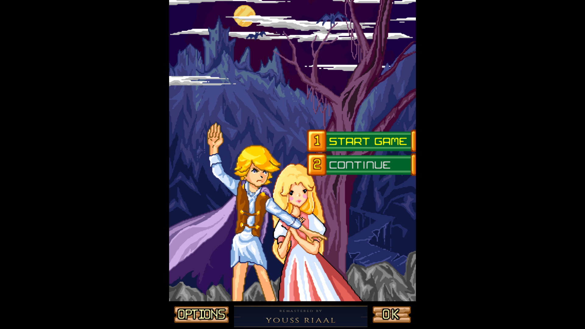
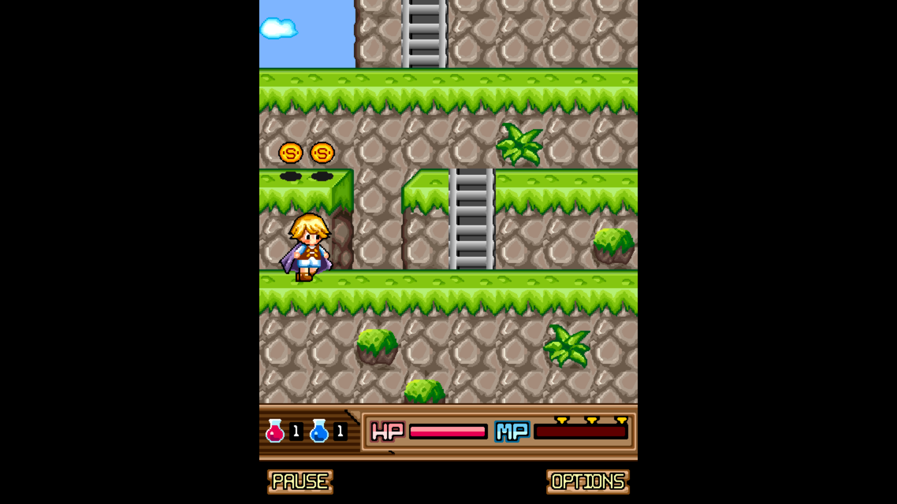

# Forgotten Warrior PS5

<strong>Remastered by Youss Riaal</strong>

A native C++ port of the classic J2ME game Forgotten Warrior for homebrew-enabled PlayStation 5 consoles, packaged as a native PS5 game folder.

[**Download v1.1**](https://github.com/youss17x/Forgotten-Warrior-PS5/releases/tag/v1.1) · [Game ZIP](https://github.com/youss17x/Forgotten-Warrior-PS5/releases/download/v1.1/ForgottenWarrior-PS5-v1.1.zip) · [Source archive](https://github.com/youss17x/Forgotten-Warrior-PS5/releases/download/v1.1/ForgottenWarrior-PS5-source-v1.1.zip) · [Build instructions](BUILD.txt) · [Credits and licenses](NOTICE.md)

## Features

- Native PS5 executable with no Java virtual machine or game payload launcher required.
- 1920 × 1080 output with enhanced pixel scaling and the original 3:4 aspect ratio preserved.
- DualSense controls and in-game controller help.
- Corrected game speed and movement while jumping.
- Custom Youss Riaal title credit, positioned between menu buttons.
- Persistent saves and clean Quit / relaunch support.
- Original sound effects; no added looping background music.

## Screenshots

### Main menu

### Gameplay

## Installation

Tested on PS5 firmware **13.60** with a homebrew game-folder setup. Other configurations have not been verified.

1. Download and extract the version 1.1 game archive above.
2. Copy the complete `FWRG00001` folder to `/data/homebrew/FWRG00001`, or `homebrew/FWRG00001` on a supported USB drive.
3. Activate your usual jailbreak, kstuff and **ShadowMount+** setup. Scan for games if needed.
4. Launch **Forgotten Warrior Remastered** from the PS5 game library.

Keep `FWRG00001` directly inside the scanned homebrew directory; avoid an extra parent folder when scan depth is 1. The title includes `eboot.bin`, `assets`, `sce_module` and `sce_sys`.

## Controls

| Button | During gameplay | In menus |
| --- | --- | --- |
| D-pad / left stick | Move; Up climbs or enters caves | Navigate |
| Cross (×) | Jump | Confirm |
| Square (□) | Attack | — |
| Circle (○) | HP potion | Back |
| Triangle (△) | MP potion | — |
| R1 | Special attack | — |
| Options | Open options | — |
| Touchpad | Pause / resume | — |
| L1 / R2 | Unassigned | — |

## Saves and troubleshooting

Saves are stored in `/data/ForgottenWarrior`. Updating the game folder preserves these saves. The runtime log is `/data/ForgottenWarrior/native-game.log`.

Black bars at the sides are intentional: the original portrait presentation is preserved without horizontal stretching. 1080p refers to output resolution; the original artwork has not been redrawn in HD.

## Source and validation

`src/` contains the game conversion, platform layer, input handling, scaler and controller help. `vendor/` contains native build tooling, compatibility code and license notices. `build-title.py` builds the native folder on Windows with the dependencies described in `BUILD.txt`.

Version 1.1 was checked on the console for launch, gameplay, controls, options, HP potion, Quit and relaunch. Host checks covered stage rendering, timing and movement. Cold-boot behavior was not independently tested.

This is an unofficial fan port. Original game content belongs to its respective owners. See [NOTICE.md](NOTICE.md) for attribution and component licensing.

## License and attribution

**PS5 port and enhancements by Youss Riaal (2026).** Original port contributions are licensed under **GPL-3.0-only**. Redistribution of covered code must preserve existing copyright and license notices, identify modifications, and meet GPL source-distribution requirements. See [LICENSE](LICENSE) and [COPYRIGHT.md](COPYRIGHT.md) for the exact scope. Original game content and third-party components retain their own rights and licenses, documented in [NOTICE.md](NOTICE.md).
